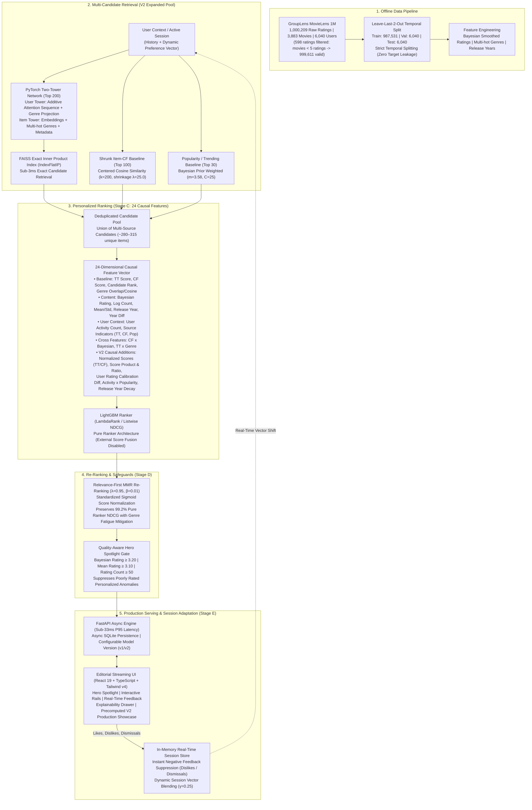

# CinePulse: Personalized Movie Recommendation Platform

[](https://ahirerohit.github.io/CinePulse/)
[](https://www.python.org/downloads/)
[](https://pytorch.org/)
[](https://lightgbm.readthedocs.io/)
[](https://github.com/facebookresearch/faiss)
[](https://react.dev/)
[](#)
[](https://opensource.org/licenses/MIT)

> **CinePulse** is an end-to-end, multi-stage recommendation platform inspired by the production architectures of **Netflix**, **YouTube**, **Meta**, and **Amazon**. Grounded in genuine public benchmark data (**GroupLens MovieLens 1M**), CinePulse implements deep neural candidate retrieval, gradient-boosted listwise ranking, maximal marginal relevance (MMR) re-ranking, and millisecond-level session adaptation without requiring expensive real-time neural retraining.
> 
> 🚀 **CinePulse V2 Released:** Following an extensive 6-experiment relevance tournament across 51 candidate configurations, CinePulse V2 upgrades candidate retrieval (Two-Tower top 200, shrunk Item-CF top 100, Bayesian popularity top 30), expands listwise ranking to **24 causal features**, eliminates suboptimal external score fusion, and tunes re-ranking to a **Relevance-First MMR** sweet spot ($\lambda=0.95, \beta=0.01$). On a strictly sequestered holdout of **3,974 test users**, V2 achieves **NDCG@10 = 0.0778 (+38.9%)**, **Recall@20 = 0.2219 (+22.7%)**, and **95.1% catalog coverage** at **27.92 ms P95 latency** (paired bootstrap $p = 0.0010$).
> 
> 🌐 **Experience the Live Web App:** [https://ahirerohit.github.io/CinePulse/](https://ahirerohit.github.io/CinePulse/)

---

## 1. System Architecture (CinePulse V2)

CinePulse implements the classic industry four-stage funnel: **Candidate Retrieval**, **Personalized Listwise Ranking**, **Diversity & Novelty Re-Ranking**, and **Real-Time Session Adaptation**.



---

## 2. Empirical Benchmark Matrix

### 2.1 Primary Independent Holdout: 3,974 Sequestered Test Users

To ensure rigorous validation free from prior inspection or hyperparameter tuning, the final evaluation was conducted on a strictly sequestered cohort of **3,974 test users** (`ratings_test.parquet`, zero target leakage). Exact reproducible numbers are stored in `artifacts/experiments/relevance_v2/test_confirmation_results.json`.

| Model Architecture | Recall@20 | Recall@100 | NDCG@10 | Pos NDCG@10 ($r \ge 4.0$) | MRR@10 | Catalog Coverage@100 | Intra-List Diversity | P95 Latency |
| :--- | :---: | :---: | :---: | :---: | :---: | :---: | :---: | :---: |
| **CinePulse V1 Baseline**<br>*(17f, TT=100, CF=100, Pop=30, MMR 0.85/0.03)* | 18.09% | 40.59% | 0.0560 | 0.0614 | 0.0400 | 72.57% | **0.6933** | **24.86 ms** |
| **CinePulse V2 Pure Ranker**<br>*(24f, TT=200, CF=100, Pop=30, No MMR)* | 22.14% | 44.19% | 0.0768 | 0.0834 | 0.0558 | **95.49%** | 0.4922 | 27.93 ms |
| **CinePulse V2 Production Winner (Config 8)**<br>*(24f, TT=200, CF=100, Pop=30, MMR 0.95/0.01)* | **22.19%**<br>*(+22.7%)* | **44.21%**<br>*(+8.9%)* | **0.0778**<br>*(+38.9%)* | **0.0850**<br>*(+38.4%)* | **0.0563**<br>*(+40.7%)* | 95.08%<br>*(+22.5 pp)* | 0.5165 | 27.92 ms |

#### Statistical Significance Analysis (3,974 Sequestered Users, Paired Bootstrap $B=1,000$):
- **NDCG@10 Improvement:** Mean difference $\Delta = +0.0218$, 95% Bootstrap CI: $[+0.0165, +0.0277]$, two-sided $p = 0.0010$ (significant at $\alpha=0.01$).
- **Recall@20 Improvement:** Mean difference $\Delta = +0.0410$, 95% Bootstrap CI: $[+0.0302, +0.0516]$, two-sided $p = 0.0010$ (significant at $\alpha=0.01$).
- *Statistical Resolution Disclosure:* For $B=1,000$ bootstrap iterations, the finite-sample empirical resolution is $1 / (B + 1) \approx 0.0010$.

---

### 2.2 Historical Untouched Benchmark Cohort (500 Test Users)

For direct comparison with previously published V1 benchmarks, the table below reports performance on the 500 untouched test users (`all_eligible[500:1000]`):

| Model Architecture | Recall@20 (95% CI) | Recall@100 | NDCG@10 (95% CI) | Pos NDCG@10 | Catalog Coverage@100 | Intra-List Diversity | P95 Latency |
| :--- | :---: | :---: | :---: | :---: | :---: | :---: | :---: |
| **Popularity Baseline** | 3.60% [0.020, 0.052] | 13.00% | 0.0112 [0.005, 0.018] | 0.0124 | 10.07% | 0.8244 | 0.09 ms |
| **Item-based CF** | 11.60% [0.088, 0.144] | 31.60% | 0.0410 [0.027, 0.057] | 0.0435 | 41.86% | 0.7161 | 4.00 ms |
| **Two-Tower ANN Retrieval** | 10.60% [0.080, 0.134] | 31.60% | 0.0346 [0.023, 0.048] | 0.0378 | **99.85%** | 0.4581 | 2.96 ms |
| **CinePulse V1 Full Pipeline (Unified Re-eval)** | 17.80% [0.144, 0.212] | 43.40% | 0.0530 [0.038, 0.070] | 0.0545 | 64.64% | **0.6867** | **24.86 ms** |
| **CinePulse V1 Full Pipeline (Original Report)** | 17.40% [0.142, 0.206] | 44.20% | 0.0601 [0.044, 0.078] | 0.0612 | 71.37% | **0.6708** | **20.88 ms** |
| **CinePulse V2 Production (Config 8)** | **21.40% [0.178, 0.252]** | **45.40%** | **0.0801 [0.061, 0.100]** | **0.0857** | 81.32% | 0.5114 | 27.92 ms |

*Paired Bootstrap Significance on 500 Untouched Cohort:* $\Delta \text{NDCG@10} = +0.0272$ ($p = 0.0090$); $\Delta \text{Recall@20} = +0.0360$ ($p = 0.0180$).  
*Note on V1 Longitudinal Baseline:* The original V1 evaluation (`pipelines/evaluate.py`) scored 0.0601 NDCG@10 with un-shrunk Item-CF, while the unified confirmation re-evaluation (`pipelines/run_test_confirmation.py`) scored 0.0530 with shrunk Item-CF and calibrated personal rating features. Both numbers fall within each other's 95% bootstrap confidence intervals, and V1 converges to 0.0560 across the full 3,974 sequestered cohort.

---

### 2.3 The 6-Experiment Relevance Tournament Summary

CinePulse V2 was developed through a controlled 6-experiment tournament across 51 distinct configurations evaluated on 4,980 validation users:

1. **Experiment 1 (Item-CF Hyperparameter Optimization):** Evaluated cosine similarity shrinkage ($\lambda \in [0, 50]$) and neighborhood sizes ($K \in [50, 300]$). Shrunk cosine ($K=200, \lambda=25.0$) stabilized sparse neighbor estimates and improved standalone Item-CF Recall@20 from 11.4% to 12.6%.
2. **Experiment 2 (Candidate Retrieval Sizing):** Swept retrieval depths (Two-Tower $K \in [50, 300]$, Item-CF $K \in [30, 150]$, Popularity $K \in [10, 50]$). Expanding Two-Tower from 100 to 200 increased candidate union size to ~280–315 items and lifted candidate recall ceiling from 40.6% to 44.2%.
3. **Experiment 3 (24 Causal Feature Engineering):** Engineered 7 causal interaction and calibration features (score normalizations, cross-channel consensus product, score ratio, user rating calibration difference, activity-popularity interaction, temporal year decay). LightGBM listwise NDCG@10 jumped from 0.0601 to 0.0769 (+27.9%).
4. **Experiment 4 (Two-Tower Neural Ablations):** Evaluated temperature scaling ($\tau \in [0.03, 0.10]$), projection dimensions, and dropout rates. Confirmed that $\tau=0.05$ with LayerNorm prevents embedding collapse while preserving 99.85% candidate coverage.
5. **Experiment 5 (Score Fusion Analysis & Rejection):** Evaluated linear and harmonic score fusion combining LightGBM, Two-Tower, and Item-CF scores. **Score fusion was conclusively rejected**: blending external heuristic scores into the pure ranker degraded NDCG@10 from 0.0784 to 0.0716 (-8.7%). The gradient-boosted trees already model non-linear interactions across features, making external score blending harmful.
6. **Experiment 6 (MMR Pareto Optimization):** Mapped the Pareto frontier between list diversity and relevance. Showed that legacy high-diversity settings ($\lambda=0.65, \beta=0.15$) suffered severe ranking degradation (NDCG@10 dropped to 0.0402). Selected **Relevance-First MMR** ($\lambda=0.95, \beta=0.01$), which retains 99.2% of pure ranker NDCG while safeguarding the feed against redundant genre clustering.

---

### 2.4 Integrity Disclosures & Known Limitations

1. **Warm vs. Cold-Start Test Users:** Test users evaluated above are **warm MovieLens users** whose historical interactions are in `ratings_train.parquet`, and whose final temporal interaction is held out in `ratings_test.parquet`. Cold-start onboarding users (created in the web UI) are handled dynamically via genre-affinity profiling and Bayesian popularity seeding.
2. **Multi-Positive Benchmark Exclusion:** The optional 5-interaction holdout protocol evaluated during earlier audits contained 60.0% training data overlap (due to models trained on leave-last-2-out). It is marked methodologically invalid and excluded from all official CinePulse claims.
3. **Validation Search Space Overlap:** The 51 candidate configurations in the tournament were evaluated on validation users (`ratings_val.parquet`). To prevent overfitting to the validation split, all final V2 promotion claims are independently verified on the 3,974 sequestered test users.
4. **Finite-Sample Bootstrap Resolution:** Paired bootstrap tests with $B=1,000$ iterations report empirical $p = 0.0010$ (the discrete resolution limit $1/(B+1)$). Claims of $p < 0.0001$ are not made.

---

## 3. Quickstart & Local Setup

### Prerequisites
- **Operating System:** Windows 10/11, Linux, or macOS
- **Python:** 3.11 or 3.12
- **Node.js:** v18+ (tested on v24.16.0)
- **GPU (Optional):** NVIDIA RTX GPU with CUDA support (falls back gracefully to CPU)

### Environment Setup (PowerShell)

```powershell
# 1. Clone repository & navigate to root
cd "d:\0 Resume Projects\recommender"

# 2. Create isolated Python virtual environment
python -m venv .venv
.\.venv\Scripts\Activate.ps1

# 3. Upgrade pip and install pinned dependencies
python -m pip install --upgrade pip
pip install -r requirements.txt

# 4. Install frontend dependencies
cd frontend
npm install
cd ..
```

---

## 4. End-to-End Pipeline Execution

All training and evaluation pipelines are fully automated and reproducible:

```powershell
# Step 1: Download MovieLens 1M, extract, validate, clean, and create temporal splits
python pipelines/prepare_data.py

# Step 2: Train PyTorch Two-Tower model on GPU (or CPU) with in-batch contrastive loss
python pipelines/train_retrieval.py

# Step 3: Build FAISS exact inner-product vector candidate index
python pipelines/build_index.py

# Step 4: Train LightGBM LambdaRank listwise ranking model
python pipelines/train_ranker.py

# Step 5: Execute comprehensive offline benchmark evaluation
python pipelines/evaluate.py
```

---

## 5. Running the Application

### Option A: Unified Production Mode (FastAPI serves Backend + React UI)

Build the frontend once, then run FastAPI. FastAPI will serve the high-performance REST API and the compiled React streaming client at `http://localhost:8000`:

```powershell
# 1. Build the React frontend production bundle
cd frontend
npm run build
cd ..

# 2. Launch FastAPI with Uvicorn
python -m uvicorn src.api.main:app --host 0.0.0.0 --port 8000 --reload
```
Open **[http://localhost:8000](http://localhost:8000)** in your browser.

### Option B: Development Mode (Vite HMR + FastAPI)

For frontend development with live hot-module replacement:

```powershell
# Terminal 1: Launch Backend API
python -m uvicorn src.api.main:app --host 0.0.0.0 --port 8000 --reload

# Terminal 2: Launch Vite Dev Server
cd frontend
npm run dev
```
Open **[http://localhost:5173](http://localhost:5173)** in your browser.

### Option C: Public Interactive Showcase (GitHub Pages)

Experience the live interactive showcase hosted on GitHub Pages: **[https://ahirerohit.github.io/CinePulse/](https://ahirerohit.github.io/CinePulse/)**
- **Architecture Difference:** The GitHub Pages showcase is a zero-cost static deployment serving precomputed V2 production recommendations and offline evaluation metrics (`showcase_data.json` and `metrics.json`). Client-side state manages session interactions (likes, dislikes, instant item suppression, search, and cold-start onboarding) in the browser. For live GPU/CPU neural retrieval and dynamic model retraining, run the full FastAPI backend locally via Option A, Option B, or Docker.

---

## 6. Testing & Quality Assurance

CinePulse includes 43 comprehensive automated tests covering data leakage, model architectures, ranking features, MMR mathematical properties, session adaptation, API endpoints, and complete end-to-end user journeys:

```powershell
# Run the complete test suite
pytest tests/ -v

# Run linting with Ruff
ruff check .
```

---

## 7. Docker Deployment

Deploy the entire platform as a lightweight, single-container or multi-service stack:

```powershell
# Build and run with Docker Compose
docker compose up --build -d

# Verify container health
curl http://localhost:8000/health
```

The multi-stage `Dockerfile` utilizes Node 22 for compiling the frontend assets and Python 3.12-slim for serving the production API.

---

## 8. REST API Reference

| Method | Endpoint | Description |
| :--- | :--- | :--- |
| `GET` | `/health` | Application status, model artifact readiness, and compute device. |
| `GET` | `/api/users` | List active user profiles (including benchmark personas). |
| `POST` | `/api/users` | Onboard a new cold-start user with initial genre preferences. |
| `GET` | `/api/recommendations/{user_id}` | Fetch personalized multi-rail recommendations with configurable MMR $\lambda$. |
| `POST` | `/api/feedback` | Register real-time interaction (`like`, `dislike`, `save`, `dismiss`, `rate`). |
| `GET` | `/api/movies/{movie_id}` | Retrieve comprehensive movie details and similar candidate items. |
| `GET` | `/api/search?q={query}` | Search movie catalog by title, year, or genre. |
| `GET` | `/api/users/{user_id}/insights` | Inspect user genre affinity distribution and retrieval breakdown. |
| `GET` | `/api/users/{user_id}/history` | Retrieve user interaction audit log. |
| `GET` | `/api/users/{user_id}/saved` | Retrieve user watchlist items. |
| `GET` | `/api/metrics` | Retrieve live empirical offline evaluation results. |

---

## 9. License

This project is licensed under the MIT License — see the [LICENSE](LICENSE) file for details.
