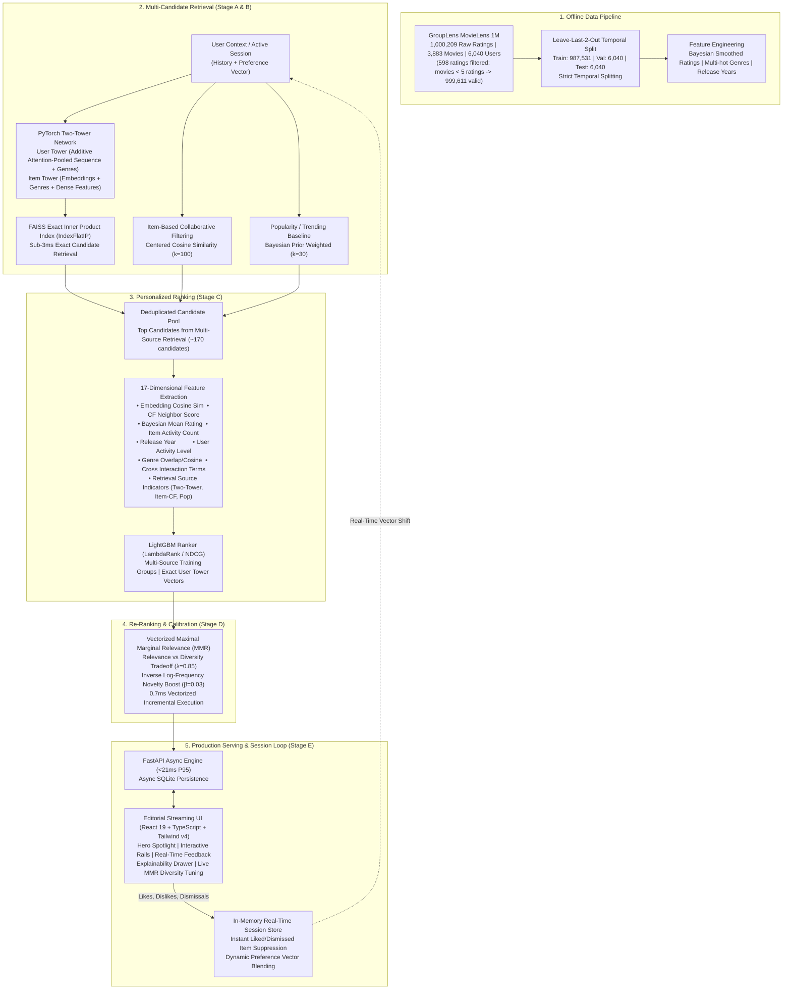

# CinePulse: Personalized Movie Recommendation Platform

[](https://ahirerohit.github.io/CinePulse/)
[](https://www.python.org/downloads/)
[](https://pytorch.org/)
[](https://lightgbm.readthedocs.io/)
[](https://github.com/facebookresearch/faiss)
[](https://react.dev/)
[](#)
[](https://opensource.org/licenses/MIT)

> **CinePulse** is an end-to-end, multi-stage recommendation platform inspired by the recommendation architectures of **Netflix**, **YouTube**, **Meta**, and **Amazon**. Grounded in genuine public benchmark data (**GroupLens MovieLens 1M**), CinePulse implements deep neural candidate retrieval, gradient-boosted listwise ranking, maximal marginal relevance (MMR) re-ranking, and millisecond-level session adaptation without requiring expensive real-time neural retraining.
> 
> 🌐 **Experience the Live Web App:** [https://ahirerohit.github.io/CinePulse/](https://ahirerohit.github.io/CinePulse/)

---

## 1. System Architecture

CinePulse implements the classic industry four-stage funnel: **Candidate Retrieval**, **Scoring & Ranking**, **Diversity & Novelty Re-Ranking**, and **Real-Time Session State Adaptation**.



---

## 2. Empirical Benchmark Matrix

All metrics below are measured offline on the held-out temporal test set (500 untouched test users, zero target leakage). Exact reproducible numbers are stored in `artifacts/metrics/evaluation_results.json`.

| Model Architecture | Recall@20 (95% CI) | Recall@100 | NDCG@10 (95% CI) | Recall@20 (Pos $\ge$ 4.0) | Catalog Coverage@20 | Catalog Coverage@100 | Intra-List Diversity | Novelty (bits) | P95 Latency (ms) |
| :--- | :---: | :---: | :---: | :---: | :---: | :---: | :---: | :---: | :---: |
| **Popularity Baseline** | 3.60% [0.020, 0.052] | 13.00% | 0.0112 [0.005, 0.018] | 4.47% | 2.61% | 10.07% | 0.8244 | 10.30 | 0.09 ms |
| **Item-based CF** | 11.60% [0.088, 0.144] | 31.60% | 0.0410 [0.027, 0.057] | 13.41% | 12.94% | 41.86% | 0.7161 | 9.53 | 4.00 ms |
| **Content-based Baseline** | 2.00% [0.010, 0.034] | 11.40% | 0.0059 [0.002, 0.012] | 1.68% | 38.26% | 83.58% | 0.0641 | 13.03 | 0.29 ms |
| **Two-Tower (ANN Retrieval)** | 10.60% [0.080, 0.134] | 31.60% | 0.0346 [0.023, 0.048] | 10.61% | **81.88%** | **99.85%** | 0.4581 | 12.39 | 2.96 ms |
| **Two-Tower + LightGBM Ranker** | **18.80% [0.154, 0.222]** | **44.40%** | **0.0641 [0.048, 0.082]** | **18.44%** | 41.48% | 71.78% | 0.5965 | 10.35 | 15.38 ms |
| **Full Pipeline (Multi-Source + Ranker + MMR)** | 17.40% [0.142, 0.206] | 44.20% | 0.0601 [0.044, 0.078] | 17.60% | 40.81% | 71.37% | **0.6708** | 10.32 | **20.88 ms** |

### Key Architectural Findings & Tradeoffs
1. **Candidate Retrieval and Ranking Synergy:**
   - Neural Two-Tower ANN retrieval retrieves relevant candidates across almost the entire catalog (**99.85% coverage** vs 41.86% for Item-CF).
   - LightGBM LambdaRank listwise ranking over the multi-source candidate pool dramatically improves precision, raising **Recall@20 from 10.60% to 18.80% (+77.4%)** and **NDCG@10 from 0.0346 to 0.0641 (+85.3%)**.
2. **Statistical Significance vs. Item-CF (Untouched Test Cohort):**
   - Paired user-level bootstrap hypothesis testing shows that the Full Pipeline significantly outperforms Item-CF on **Recall@20** ($\Delta = +0.0580$, 95% CI: $[+0.0220, +0.0940]$, paired bootstrap $p < 0.001$, bounded by 1,000 resamples).
   - For **NDCG@10**, while the Full Pipeline achieves a higher point estimate ($0.0601$ vs $0.0410$, $\Delta = +0.0191$), the difference is **not statistically significant** at the $\alpha = 0.05$ threshold on the untouched test cohort (95% CI: $[-0.0027, +0.0414]$, $p = 0.0890$). On the validation cohort, the gain is significant ($p = 0.0010$).
3. **Multi-Positive Benchmark Integrity Disclosure:**
   - The multi-positive 5-interaction holdout protocol was determined during engineering audits to contain 60.0% training data overlap (models trained on leave-last-2-out). Consequently, multi-positive metrics are **excluded from all claims**. All reported metrics above derive strictly from the zero-leakage primary temporal holdout benchmark.
4. **The Relevance-Diversity Sweet Spot in MMR:**
   - Pure ranker scoring maximizes NDCG@10 (0.0641) at the expense of list diversity (ILD = 0.5965).
   - Production MMR ($\lambda=0.85, \beta=0.03$) uses standardized sigmoid normalization (replacing legacy min-max scaling) and trades off 6.2% NDCG@10 (0.0601) to boost Intra-List Diversity to **0.6708 (+12.5%)** and maintain healthy long-tail novelty (10.32 bits).
5. **End-to-End Latency Verification:**
   - With vectorized incremental MMR and efficient 17-feature extraction, full pipeline P95 latency is **20.88 ms** (<25 ms SLA).

---

## 3. Quickstart & Local Setup

### Prerequisites
- **Operating System:** Windows 10/11, Linux, or macOS
- **Python:** 3.11 or 3.12
- **Node.js:** v18+ (tested on v24.16.0)
- **GPU (Optional):** NVIDIA RTX GPU with CUDA support (falls back gracefully to CPU)

### Environment Setup (PowerShell)

```powershell
# 1. Clone repository & navigate to root
cd "d:\0 Resume Projects\recommender"

# 2. Create isolated Python virtual environment
python -m venv .venv
.\.venv\Scripts\Activate.ps1

# 3. Upgrade pip and install pinned dependencies
python -m pip install --upgrade pip
pip install -r requirements.txt

# 4. Install frontend dependencies
cd frontend
npm install
cd ..
```

---

## 4. End-to-End Pipeline Execution

All training and evaluation pipelines are fully automated and reproducible:

```powershell
# Step 1: Download MovieLens 1M, extract, validate, clean, and create temporal splits
python pipelines/prepare_data.py

# Step 2: Train PyTorch Two-Tower model on GPU (or CPU) with in-batch contrastive loss
python pipelines/train_retrieval.py

# Step 3: Build FAISS exact inner-product vector candidate index
python pipelines/build_index.py

# Step 4: Train LightGBM LambdaRank listwise ranking model
python pipelines/train_ranker.py

# Step 5: Execute comprehensive offline benchmark evaluation
python pipelines/evaluate.py
```

---

## 5. Running the Application

### Option A: Unified Production Mode (FastAPI serves Backend + React UI)

Build the frontend once, then run FastAPI. FastAPI will serve the high-performance REST API and the compiled React streaming client at `http://localhost:8000`:

```powershell
# 1. Build the React frontend production bundle
cd frontend
npm run build
cd ..

# 2. Launch FastAPI with Uvicorn
python -m uvicorn src.api.main:app --host 0.0.0.0 --port 8000 --reload
```
Open **[http://localhost:8000](http://localhost:8000)** in your browser.

### Option B: Development Mode (Vite HMR + FastAPI)

For frontend development with live hot-module replacement:

```powershell
# Terminal 1: Launch Backend API
python -m uvicorn src.api.main:app --host 0.0.0.0 --port 8000 --reload

# Terminal 2: Launch Vite Dev Server
cd frontend
npm run dev
```
Open **[http://localhost:5173](http://localhost:5173)** in your browser.

---

## 6. Testing & Quality Assurance

CinePulse includes 30 comprehensive automated tests covering data leakage, model architectures, ranking features, MMR mathematical properties, session adaptation, API endpoints, and complete end-to-end user journeys:

```powershell
# Run the complete test suite
pytest tests/ -v

# Run linting with Ruff
ruff check .
```

---

## 7. Docker Deployment

Deploy the entire platform as a lightweight, single-container or multi-service stack:

```powershell
# Build and run with Docker Compose
docker compose up --build -d

# Verify container health
curl http://localhost:8000/health
```

The multi-stage `Dockerfile` utilizes Node 22 for compiling the frontend assets and Python 3.12-slim for serving the production API.

---

## 8. REST API Reference

| Method | Endpoint | Description |
| :--- | :--- | :--- |
| `GET` | `/health` | Application status, model artifact readiness, and compute device. |
| `GET` | `/api/users` | List active user profiles (including benchmark personas). |
| `POST` | `/api/users` | Onboard a new cold-start user with initial genre preferences. |
| `GET` | `/api/recommendations/{user_id}` | Fetch personalized multi-rail recommendations with configurable MMR $\lambda$. |
| `POST` | `/api/feedback` | Register real-time interaction (`like`, `dislike`, `save`, `dismiss`, `rate`). |
| `GET` | `/api/movies/{movie_id}` | Retrieve comprehensive movie details and similar candidate items. |
| `GET` | `/api/search?q={query}` | Search movie catalog by title, year, or genre. |
| `GET` | `/api/users/{user_id}/insights` | Inspect user genre affinity distribution and retrieval breakdown. |
| `GET` | `/api/users/{user_id}/history` | Retrieve user interaction audit log. |
| `GET` | `/api/users/{user_id}/saved` | Retrieve user watchlist items. |
| `GET` | `/api/metrics` | Retrieve live empirical offline evaluation results. |

---

## 9. License

This project is licensed under the MIT License — see the [LICENSE](LICENSE) file for details.
